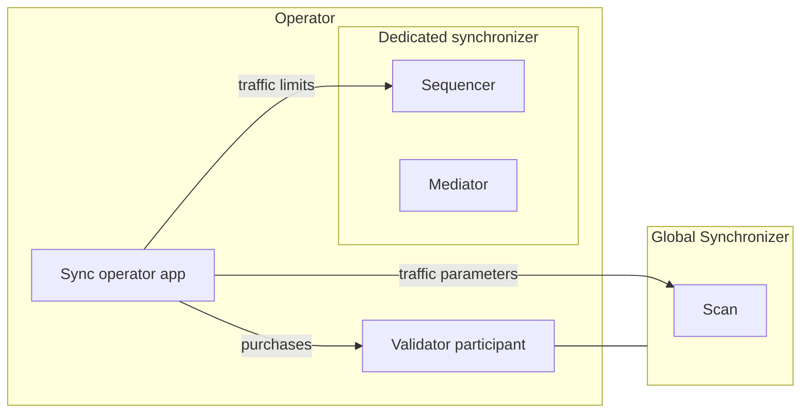

The operator of a dedicated synchronizer is the organization that runs it and grants the traffic its members [buy with Canton Coin](/global-synchronizer/extension-synchronizers/dedicated-synchronizer-traffic). This page deploys a dedicated synchronizer with the Splice Helm charts and registers it with the SVs. For day-to-day tasks, see [Dedicated Synchronizer Operations](/global-synchronizer/extension-synchronizers/dedicated-synchronizer-operations); for upgrades, see [Dedicated Synchronizer Upgrades](/global-synchronizer/extension-synchronizers/dedicated-synchronizer-upgrades).

## Components

The operator runs:

- **The dedicated synchronizer's sequencer and mediator**, from the `splice-global-domain` chart that SVs use for their nodes.
- **A validator** on the Global Synchronizer. Its participant hosts the operator party, which observes every traffic purchase for the synchronizer.
- **The sync operator app.** It reads those purchases through the participant's Ledger API, reads the Global Synchronizer's traffic parameters from Scan, and sets traffic limits and parameters through the sequencer's Admin API.



The sync operator app does not create the synchronizer. It serves the synchronizer that its configured sequencer belongs to.

## Before you start

- Deploy a validator as described in [Kubernetes Validator Deployment](/global-synchronizer/deployment/validator-kubernetes), in the `validator` namespace. This page installs everything else into the same namespace.
- Provision a PostgreSQL instance for the synchronizer's nodes, prepared as in [Preparing the target instance](/global-synchronizer/production-operations/validator-postgres-migration#preparing-the-target-instance): a `cnadmin` user with the `CREATEDB` privilege and an empty `cantonnet` database. The charts create the databases they need. Do not use the `splice-postgres` chart for it; that chart is deprecated.
- Create a client for the sync operator app in your IAM, the way you did for the validator app.
- Export these for the commands below. `OIDC_AUTHORITY_URL`, `OIDC_AUTHORITY_LEDGER_API_AUDIENCE` and `OIDC_AUTHORITY_LEDGER_API_SCOPE` keep the values from your validator's setup.

```bash
export CHART_VERSION=...                # the Splice release, as for your validator
export SYNC_POSTGRES_PASSWORD=...       # cnadmin's password on the synchronizer's PostgreSQL
export SYNC_OPERATOR_CLIENT_ID=...      # the sync operator app's client in your IAM
export SYNC_OPERATOR_CLIENT_SECRET=...
export TRUSTED_SCAN_URL=...             # the Scan your validator uses
```

In the values files below, replace the same names, written without `$`, with these values.

## Set up

Set up runs in this order: create the operator party, deploy the synchronizer nodes, bootstrap the synchronizer, deploy the sync operator app, then register the synchronizer.

### Create the operator party

The operator party lives on your validator's participant. The sync operator app uses a Ledger API user whose primary party is the operator party. Your validator creates both from an app instance. Add this entry to the `additionalEnvVars` list in your validator's values file, next to any entries already there:

```yaml
additionalEnvVars:
  - name: ADDITIONAL_CONFIG_SYNC_OPERATOR_APP_INSTANCE
    value: |
      canton.validator-apps.validator_backend.app-instances.syncOperator {
        service-user = "SYNC_OPERATOR_LEDGER_API_USER"
        dars = []
      }
```

Replace `SYNC_OPERATOR_LEDGER_API_USER` with the app's user ID, for example `SYNC_OPERATOR_CLIENT_ID@clients`. It is the same value as `ledger-api-user` in the app's [auth secret](#deploy-the-sync-operator-app). Upgrade the validator release with the values files you installed it with:

```bash
helm upgrade validator oci://ghcr.io/digital-asset/decentralized-canton-sync/helm/splice-validator -n validator --version ${CHART_VERSION} -f splice-node/examples/sv-helm/validator-values.yaml -f splice-node/examples/sv-helm/standalone-validator-values.yaml --wait
```

Then read the operator party ID in your participant's [Canton console](/global-synchronizer/reference/canton-console-reference#participant-console):

```scala
participant.ledger_api.users.get("SYNC_OPERATOR_LEDGER_API_USER").primaryParty.map(_.toProtoPrimitive)
```

### Deploy the synchronizer nodes

Create a secret with the password of the synchronizer's PostgreSQL:

```bash
kubectl create secret generic dedicated-sync-pg-secret \
    --from-literal=postgresPassword=${SYNC_POSTGRES_PASSWORD} \
    -n validator
```

Create `dedicated-sync-values.yaml`. The `0` in the names is the synchronizer's serial, which goes up with each [upgrade](/global-synchronizer/extension-synchronizers/dedicated-synchronizer-upgrades):

```yaml
sequencer:
  persistence:
    host: SYNC_POSTGRES_HOST
    port: 5432
    secretName: dedicated-sync-pg-secret
    databaseName: sequencer_0
  driver:
    type: "cantonbft"
    externalAddress: "dedicated-sync-0-sequencer"
    externalPort: 5010
    persistence:
      databaseName: sequencer_cantonbft_0
  additionalEnvVars:
    - name: ADDITIONAL_CONFIG_AUTO_INIT
      value: |
        canton.sequencers.sequencer.init {
          identity.type = auto
          generate-topology-transactions-and-keys = true
        }
mediator:
  persistence:
    host: SYNC_POSTGRES_HOST
    port: 5432
    secretName: dedicated-sync-pg-secret
    databaseName: mediator_0
  additionalEnvVars:
    - name: ADDITIONAL_CONFIG_AUTO_INIT
      value: |
        canton.mediators.mediator.init {
          identity.type = auto
          generate-topology-transactions-and-keys = true
        }
```

Replace `SYNC_POSTGRES_HOST` with the address of the synchronizer's PostgreSQL. The sequencer runs on the Canton BFT orderer as a single node, with its own database. Without the `ADDITIONAL_CONFIG_AUTO_INIT` entries, both nodes wait for an SV app to initialize them. Install the chart:

```bash
helm install dedicated-sync-0 oci://ghcr.io/digital-asset/decentralized-canton-sync/helm/splice-global-domain -n validator --version ${CHART_VERSION} -f dedicated-sync-values.yaml --wait
```

This creates the services `dedicated-sync-0-sequencer`, with the public API on port 5008 and the Admin API on 5009, and `dedicated-sync-0-mediator`, with the Admin API on 5007.

Expose the sequencer's public API to the validators that will join: route a URL such as `https://sequencer-0.dedicated.YOUR_HOSTNAME` to port 5008 of the service `dedicated-sync-0-sequencer`, the way the SV deployment routes its sequencer (see [Configuring the Cluster Ingress](/global-synchronizer/deployment/kubernetes-deployment#configuring-the-cluster-ingress)). That URL is what you send validators.

### Bootstrap the synchronizer

Bootstrap the synchronizer once, from a Canton console that reaches both nodes. Open one on the sequencer pod as described in [Access in a K8s cluster](/global-synchronizer/reference/canton-console-reference#access-in-a-k8s-cluster), with this `console.conf`:

```
canton {
  remote-sequencers {
    sequencer {
      public-api {
        address = dedicated-sync-0-sequencer
        port = 5008
      }
      admin-api {
        address = dedicated-sync-0-sequencer
        port = 5009
      }
    }
  }
  remote-mediators {
    mediator {
      admin-api {
        address = dedicated-sync-0-mediator
        port = 5007
      }
    }
  }
  features.enable-preview-commands = yes
}
```

Then run the following. It bootstraps the synchronizer with the sequencer as its owner, restricts onboarding to participants you permission, and, as the last step, turns on traffic management with no base traffic:

```scala
val synchronizerId = bootstrap.synchronizer(
  synchronizerName = "dedicated",
  sequencers = Seq(sequencer),
  mediators = Seq(mediator),
  synchronizerOwners = Seq(sequencer),
  synchronizerThreshold = PositiveInt.one,
  staticSynchronizerParameters = StaticSynchronizerParameters.defaultsWithoutKMS(ProtocolVersion.latest),
).logical

sequencer.topology.synchronizer_parameters.propose_update(
  synchronizerId,
  _.update(onboardingRestriction = OnboardingRestriction.RestrictedOpen),
  signedBy = Some(sequencer.id.uid.namespace.fingerprint),
)

utils.retry_until_true {
  sequencer.topology.synchronizer_parameters
    .get_dynamic_synchronizer_parameters(synchronizerId)
    .onboardingRestriction == OnboardingRestriction.RestrictedOpen
}

sequencer.topology.synchronizer_parameters.propose_update(
  synchronizerId,
  _.update(trafficControl =
    Some(
      TrafficControlParameters(
        maxBaseTrafficAmount = NonNegativeLong.zero,
        readVsWriteScalingFactor = PositiveInt.tryCreate(200),
        maxBaseTrafficAccumulationDuration = PositiveFiniteDuration.ofMinutes(10),
        setBalanceRequestSubmissionWindowSize = PositiveFiniteDuration.ofMinutes(5),
        enforceRateLimiting = true,
        baseEventCost = NonNegativeLong.zero,
        freeConfirmationResponses = false,
      )
    )
  ),
  signedBy = Some(sequencer.id.uid.namespace.fingerprint),
)

utils.retry_until_true {
  sequencer.topology.synchronizer_parameters
    .get_dynamic_synchronizer_parameters(synchronizerId)
    .trafficControl
    .isDefined
}

println(synchronizerId.toProtoPrimitive)
```

The last line prints the synchronizer ID, `dedicated::` followed by the sequencer's namespace fingerprint. Export it as `SYNCHRONIZER_ID`. You send it to the SVs and to the validators that join.

Deploy the sync operator app next. Until it runs, even the mediator has no traffic, so transactions on the synchronizer fail.

### Deploy the sync operator app

The sync operator app ships as the `splice-sync-operator` chart. In the `validator` namespace it reaches your participant under its default name, `participant`. It keeps its data in a database of its own on your validator's PostgreSQL, created at startup, and reads that PostgreSQL's password from the `postgres-secrets` secret your validator uses.

Create a Ledger API auth secret for the operator user, the same way as the validator's:

```bash
kubectl create --namespace validator secret generic splice-app-sync-operator-ledger-api-auth \
    "--from-literal=ledger-api-user=${SYNC_OPERATOR_CLIENT_ID}@clients" \
    "--from-literal=url=${OIDC_AUTHORITY_URL}/.well-known/openid-configuration" \
    "--from-literal=client-id=${SYNC_OPERATOR_CLIENT_ID}" \
    "--from-literal=client-secret=${SYNC_OPERATOR_CLIENT_SECRET}" \
    "--from-literal=audience=${OIDC_AUTHORITY_LEDGER_API_AUDIENCE}" \
    "--from-literal=scope=${OIDC_AUTHORITY_LEDGER_API_SCOPE}"
```

Create `sync-operator-values.yaml`, replacing `TRUSTED_SCAN_URL` and `VALIDATOR_POSTGRES_HOST`, the `persistence.host` from your validator's values:

```yaml
scanAddress: "TRUSTED_SCAN_URL"
sequencerAddress: "dedicated-sync-0-sequencer"
persistence:
  host: VALIDATOR_POSTGRES_HOST
```

The app reaches the sequencer's Admin API on port 5009 and the participant's Ledger API and Admin API on ports 5001 and 5002, the ports the Splice charts use. Install the chart:

```bash
helm install sync-operator oci://ghcr.io/digital-asset/decentralized-canton-sync/helm/splice-sync-operator -n validator --version ${CHART_VERSION} -f sync-operator-values.yaml --wait
```

The app reports ready on `/api/syncoperator/readyz`, port 5016, once it has reached the participant, Scan and the sequencer and found traffic management on. From then on it:

- keeps the base traffic at zero, the read versus write scaling factor at the Global Synchronizer's, and confirmation responses free;
- gives the synchronizer's mediators unlimited traffic, since they cannot buy any;
- sets each member's traffic limit on the sequencer to its total purchased traffic whenever a purchase lands.

### Register the synchronizer

The SVs register the synchronizer by a governance vote. Send them:

- the synchronizer ID from [Bootstrap the synchronizer](#bootstrap-the-synchronizer);
- the operator party ID from [Create the operator party](#create-the-operator-party);
- the traffic discount you agree with them, where 1 means no discount.

An SV proposes the vote as described in [Registering a dedicated synchronizer](/global-synchronizer/deployment/sv-operations#registering-a-dedicated-synchronizer). Once it passes, Scan serves the registration:

```bash
curl "${TRUSTED_SCAN_URL}/api/scan/v0/synchronizers/${SYNCHRONIZER_ID}/registration"
```

From then on, validators can buy traffic for the synchronizer, and the app grants it. The registration fixes the operator party: a different operator needs a new synchronizer and a new registration. The SVs can change the discount, or offboard the synchronizer, by later votes. After an offboarding, purchases for it are refused.

Next, [admit validators](/global-synchronizer/extension-synchronizers/dedicated-synchronizer-operations#admit-a-validator) as they ask to join.

## Run the synchronizer on several nodes

For fault tolerance, run the synchronizer on several sequencer and mediator nodes, as a [decentralized synchronizer](/global-synchronizer/extension-synchronizers/synchronizer-operations#set-up-a-decentralized-synchronizer). The tested layout has four nodes:

- Every sequencer lists the other three as peers of its BFT orderer.
- All four sequencers own the synchronizer, and three of them must sign each topology change.
- Each mediator connects to its own node's sequencer, and two mediators must agree.
- The sequencer threshold goes from 1 to 2, so a traffic limit changes only once two sequencers have submitted the same value.
- Each sequencer has its own sync operator app, with its own database, all acting as the registered operator party.

Bootstrap the four nodes from one console that reaches all of them, named `sequencer1` to `sequencer4` and `mediator1` to `mediator4`:

```scala
val sequencers = Seq(sequencer1, sequencer2, sequencer3, sequencer4)
val mediators = Seq(mediator1, mediator2, mediator3, mediator4)
val owners = sequencers.take(3)

val synchronizerId = bootstrap.synchronizer(
  synchronizerName = "dedicated",
  sequencers = sequencers,
  mediatorsToSequencers = mediators
    .zip(sequencers)
    .map { case (mediator, sequencer) =>
      mediator -> (Seq(sequencer), PositiveInt.one, NonNegativeInt.zero)
    }
    .toMap,
  synchronizerOwners = sequencers,
  synchronizerThreshold = PositiveInt.tryCreate(3),
  staticSynchronizerParameters = StaticSynchronizerParameters.defaultsWithoutKMS(ProtocolVersion.latest),
  mediatorRequestAmplification = SubmissionRequestAmplification.NoAmplification,
  mediatorThreshold = PositiveInt.tryCreate(2),
).logical

owners.foreach(owner =>
  owner.topology.sequencers.propose(
    synchronizerId,
    threshold = PositiveInt.tryCreate(2),
    active = sequencers.map(_.id),
    signedBy = Some(owner.id.uid.namespace.fingerprint),
    synchronize = None,
  )
)

utils.retry_until_true {
  sequencers.head.topology.sequencers
    .list(store = Some(TopologyStoreId.Synchronizer(synchronizerId)))
    .exists(_.item.threshold == PositiveInt.tryCreate(2))
}
```

Then restrict onboarding and turn on traffic management as in [Bootstrap the synchronizer](#bootstrap-the-synchronizer), one change at a time: each of the three `owners` proposes the change, and you wait until it is effective before the next one.

With the charts:

- Each node is its own `splice-global-domain` release. Set `driver.externalAddress` and `driver.externalPort` to where the other nodes reach it. The chart starts the BFT orderer with no peers, so list them in the same `sequencer.additionalEnvVars` list as the auto-init entry. The images apply `ADDITIONAL_CONFIG_*` variables in name order, so the name must sort after the chart's `ADDITIONAL_CONFIG_SEQUENCER_DRIVER_BFT`. Peer connections use TLS by default; see [Configure initial peers](/global-synchronizer/extension-synchronizers/synchronizer-operations#configure-initial-peers-optional).

  ```yaml
  - name: ADDITIONAL_CONFIG_SEQUENCER_PEERS
    value: |
      canton.sequencers.sequencer.sequencer.config.initial-network.peer-endpoints = [
        { address = "sequencer-p2p-b.dedicated.example.com", port = 443 }
        { address = "sequencer-p2p-c.dedicated.example.com", port = 443 }
        { address = "sequencer-p2p-d.dedicated.example.com", port = 443 }
      ]
  ```

- Each sync operator app is its own `splice-sync-operator` release, in its own namespace since the chart's resource names are fixed. Each namespace needs the app's auth secret and a PostgreSQL password secret. Set `sequencerAddress` to that node's sequencer, `participantAddress` to `participant.validator.svc.cluster.local`, `persistence.host` to the PostgreSQL's full address, and a `persistence.databaseName` of its own.
- Validators connect to every sequencer, as in [Connect to decentralized Sequencers](/global-synchronizer/extension-synchronizers/linking-validator-multi-sync#connect-to-decentralized-sequencers). An `extraDomains` entry holds one URL, so a member that adds the synchronizer there for automatic top-ups ends up connected to one sequencer.

## Bring an existing synchronizer onto paid traffic

A dedicated synchronizer that already runs without paid traffic moves onto it in place, without a rebuild. In this order:

1. **Register** the synchronizer by vote, as in [Register the synchronizer](#register-the-synchronizer).
2. **Restrict onboarding** if it is open. In your console, run `val synchronizerId = sequencer.synchronizer_id`. Permission every participant already connected, as in [Admit a validator](/global-synchronizer/extension-synchronizers/dedicated-synchronizer-operations#admit-a-validator). Then set `onboardingRestriction` to `RestrictedOpen` with the command from [Bootstrap the synchronizer](#bootstrap-the-synchronizer). The restriction deactivates any participant without a permission, connected or not.
3. **Have every member buy traffic** for the synchronizer.
4. **Switch to paid traffic** last, since that is the step that stops anyone without purchased traffic. Deploy the sync operator app. If traffic management is off, install the app without `--wait`, since it is not ready until traffic management is on, and then turn traffic management on with the command from [Bootstrap the synchronizer](#bootstrap-the-synchronizer). The app grants each member its purchased total and sets the base traffic to zero.

If traffic management was already on with limits you set by hand, the app does not lower them. It raises a member's limit only once the member's purchased total is higher, so members keep their current limits until their purchases catch up.
