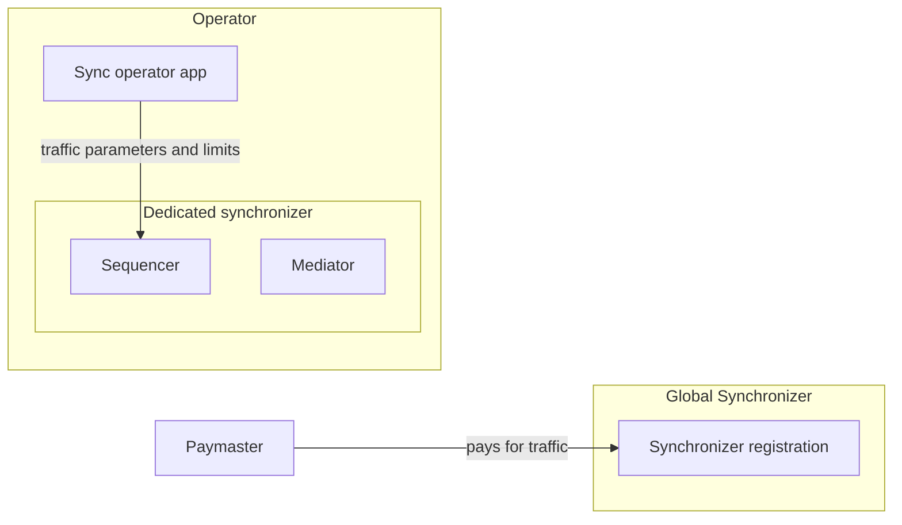

The operator of a dedicated synchronizer is the organization that runs it and gives its members traffic. On a registered dedicated synchronizer, every member has unlimited traffic, and a [paymaster pays for it with Canton Coin](/global-synchronizer/extension-synchronizers/dedicated-synchronizer-traffic). This page deploys a dedicated synchronizer with the Splice Helm charts and registers it with the SVs. For day-to-day tasks, see [Dedicated Synchronizer Operations](/global-synchronizer/extension-synchronizers/dedicated-synchronizer-operations); for upgrades, see [Dedicated Synchronizer Upgrades](/global-synchronizer/extension-synchronizers/dedicated-synchronizer-upgrades).

## Components

The operator runs:

- **The dedicated synchronizer's sequencer and mediator**, from the `splice-global-domain` chart that SVs use for their nodes.
- **The sync operator app.** It sets the synchronizer's traffic parameters and its members' traffic limits through the sequencer's Admin API. It needs no validator and no connection to the Global Synchronizer.

The paymaster is a party that holds Canton Coin on the Global Synchronizer. It can belong to the organization that runs the synchronizer or to another one.



The sync operator app does not create the synchronizer. It serves the synchronizer that its configured sequencer belongs to.

## Before you start

- Create a namespace for the synchronizer, for example with `kubectl create ns dedicated-sync`. This page installs everything into it.
- Provision a PostgreSQL instance for the synchronizer's nodes and the sync operator app, prepared as in [Preparing the target instance](/global-synchronizer/production-operations/validator-postgres-migration#preparing-the-target-instance): a `cnadmin` user with the `CREATEDB` privilege and an empty `cantonnet` database. The charts create the databases they need. Do not use the `splice-postgres` chart for it; that chart is deprecated.
- Know the party that pays for the synchronizer's traffic, the paymaster. You send its party ID to the SVs when you [register the synchronizer](#register-the-synchronizer).
- Export these for the commands below:

```bash
export CHART_VERSION=...                # the Splice release
export SYNC_POSTGRES_PASSWORD=...       # cnadmin's password on the synchronizer's PostgreSQL
```

## Set up

Set up runs in this order: deploy the synchronizer nodes, bootstrap the synchronizer, deploy the sync operator app, then register the synchronizer.

### Deploy the synchronizer nodes

Create a secret with the password of the synchronizer's PostgreSQL:

```bash
kubectl create secret generic dedicated-sync-pg-secret \
    --from-literal=postgresPassword=${SYNC_POSTGRES_PASSWORD} \
    -n dedicated-sync
```

Create `dedicated-sync-values.yaml`. The `0` in the names is the synchronizer's serial, which goes up with each [upgrade](/global-synchronizer/extension-synchronizers/dedicated-synchronizer-upgrades):

```yaml
sequencer:
  persistence:
    host: SYNC_POSTGRES_HOST
    port: 5432
    secretName: dedicated-sync-pg-secret
    databaseName: sequencer_0
  driver:
    type: "cantonbft"
    externalAddress: "dedicated-sync-0-sequencer"
    externalPort: 5010
    persistence:
      databaseName: sequencer_cantonbft_0
  additionalEnvVars:
    - name: ADDITIONAL_CONFIG_AUTO_INIT
      value: |
        canton.sequencers.sequencer.init {
          identity.type = auto
          generate-topology-transactions-and-keys = true
        }
mediator:
  persistence:
    host: SYNC_POSTGRES_HOST
    port: 5432
    secretName: dedicated-sync-pg-secret
    databaseName: mediator_0
  additionalEnvVars:
    - name: ADDITIONAL_CONFIG_AUTO_INIT
      value: |
        canton.mediators.mediator.init {
          identity.type = auto
          generate-topology-transactions-and-keys = true
        }
```

Replace `SYNC_POSTGRES_HOST` with the address of the synchronizer's PostgreSQL. The sequencer runs on the Canton BFT orderer as a single node, with its own database. Without the `ADDITIONAL_CONFIG_AUTO_INIT` entries, both nodes wait for an SV app to initialize them. Install the chart:

```bash
helm install dedicated-sync-0 oci://ghcr.io/digital-asset/decentralized-canton-sync/helm/splice-global-domain -n dedicated-sync --version ${CHART_VERSION} -f dedicated-sync-values.yaml --wait
```

This creates the services `dedicated-sync-0-sequencer`, with the public API on port 5008 and the Admin API on 5009, and `dedicated-sync-0-mediator`, with the Admin API on 5007.

Expose the sequencer's public API to the validators that will join: route a URL such as `https://sequencer-0.dedicated.YOUR_HOSTNAME` to port 5008 of the service `dedicated-sync-0-sequencer`, the way the SV deployment routes its sequencer (see [Configuring the Cluster Ingress](/global-synchronizer/deployment/kubernetes-deployment#configuring-the-cluster-ingress)). That URL is what you send validators.

### Bootstrap the synchronizer

Bootstrap the synchronizer once, from a Canton console that reaches both nodes. Open one on the sequencer pod as described in [Access in a K8s cluster](/global-synchronizer/reference/canton-console-reference#access-in-a-k8s-cluster), with this `console.conf`:

```
canton {
  remote-sequencers {
    sequencer {
      public-api {
        address = dedicated-sync-0-sequencer
        port = 5008
      }
      admin-api {
        address = dedicated-sync-0-sequencer
        port = 5009
      }
    }
  }
  remote-mediators {
    mediator {
      admin-api {
        address = dedicated-sync-0-mediator
        port = 5007
      }
    }
  }
  features.enable-preview-commands = yes
}
```

Then run the following. It bootstraps the synchronizer on protocol version 37 with the sequencer as its owner, restricts onboarding to participants you permission, and turns on traffic management with no base traffic. The sync operator app requires all three:

```scala
val synchronizerId = bootstrap.synchronizer(
  synchronizerName = "dedicated",
  sequencers = Seq(sequencer),
  mediators = Seq(mediator),
  synchronizerOwners = Seq(sequencer),
  synchronizerThreshold = PositiveInt.one,
  staticSynchronizerParameters = StaticSynchronizerParameters.defaults(ProtocolVersion.v37),
).logical

sequencer.topology.synchronizer_parameters.propose_update(
  synchronizerId,
  _.update(
    trafficControl = Some(
      TrafficControlParameters(
        maxBaseTrafficAmount = NonNegativeLong.zero,
        readVsWriteScalingFactor = PositiveInt.tryCreate(4),
        maxBaseTrafficAccumulationDuration = PositiveFiniteDuration.ofMinutes(10),
        setBalanceRequestSubmissionWindowSize = PositiveFiniteDuration.ofMinutes(2),
        enforceRateLimiting = true,
        baseEventCost = NonNegativeLong.zero,
        freeConfirmationResponses = true,
      )
    ),
    onboardingRestriction = OnboardingRestriction.RestrictedOpen,
  ),
  signedBy = Some(sequencer.id.uid.namespace.fingerprint),
)

utils.retry_until_true {
  val parameters = sequencer.topology.synchronizer_parameters
    .get_dynamic_synchronizer_parameters(synchronizerId)
  parameters.trafficControl.isDefined && parameters.onboardingRestriction.isRestricted
}

println(synchronizerId.toProtoPrimitive)
```

The last line prints the synchronizer ID, `dedicated::` followed by a fingerprint. You send it to the SVs when you [register the synchronizer](#register-the-synchronizer).

Deploy the sync operator app next. Until it runs, even the mediator has no traffic, so transactions on the synchronizer fail.

### Deploy the sync operator app

The sync operator app ships as the `splice-sync-operator` chart. It keeps its data in a database of its own, which the chart creates on the synchronizer's PostgreSQL.

Create `sync-operator-values.yaml`, replacing `SYNC_POSTGRES_HOST` as before:

```yaml
sequencerAddress: "dedicated-sync-0-sequencer"
persistence:
  host: SYNC_POSTGRES_HOST
  secretName: dedicated-sync-pg-secret
```

The app reaches the sequencer's Admin API on port 5009, the port the Splice charts use. Install the chart:

```bash
helm install sync-operator oci://ghcr.io/digital-asset/decentralized-canton-sync/helm/splice-sync-operator -n dedicated-sync --version ${CHART_VERSION} -f sync-operator-values.yaml --wait
```

The app reports ready on `/api/syncoperator/readyz`, port 5016, once it has reached the sequencer and found the synchronizer on protocol version 37 or later, with onboarding restricted and traffic management on. From then on it:

- keeps the base traffic at zero and confirmation responses free;
- keeps the read versus write scaling factor at 4, the submission window for traffic limits at 2 minutes and the base event cost at 0;
- gives the synchronizer's mediators and every participant you admit unlimited traffic.

The three values in the second item are defaults in the app's own configuration, chosen to match the Global Synchronizer. The app does not read them from the Global Synchronizer.

### Register the synchronizer

The SVs register the synchronizer by a governance vote. Send them:

- the synchronizer ID from [Bootstrap the synchronizer](#bootstrap-the-synchronizer);
- the paymaster's party ID;
- the maximum app activity weight and the maximum asset activity weight you agree with them.

An SV proposes the vote as described in [Registering a dedicated synchronizer](/global-synchronizer/deployment/sv-operations#registering-a-dedicated-synchronizer). Once it passes, the paymaster can [pay for the synchronizer's traffic](/global-synchronizer/extension-synchronizers/dedicated-synchronizer-traffic#pay-for-traffic).

The SVs can change the paymaster or the weights, or offboard the synchronizer, by later votes. After an offboarding, payments for it are refused.

Next, [admit validators](/global-synchronizer/extension-synchronizers/dedicated-synchronizer-operations#admit-a-validator) as they ask to join.

## Run the synchronizer on several nodes

For fault tolerance, run the synchronizer on several sequencer and mediator nodes, as a [decentralized synchronizer](/global-synchronizer/extension-synchronizers/synchronizer-operations#set-up-a-decentralized-synchronizer). The tested layout has four nodes:

- Every sequencer lists the other three as peers of its BFT orderer.
- All four sequencers own the synchronizer, and three of them must sign each topology change.
- Each mediator connects to its own node's sequencer, and two mediators must agree.
- The sequencer threshold goes from 1 to 2, so a traffic limit changes only once two sequencers have submitted the same value.
- Each sequencer has its own sync operator app, with its own database.

Bootstrap the four nodes from one console that reaches all of them, named `sequencer1` to `sequencer4` and `mediator1` to `mediator4`:

```scala
val bftSequencers = Seq(sequencer1, sequencer2, sequencer3, sequencer4)
val bftMediators = Seq(mediator1, mediator2, mediator3, mediator4)
val owners = bftSequencers.take(3)

val synchronizerId = bootstrap.synchronizer(
  synchronizerName = "dedicated",
  sequencers = bftSequencers,
  mediatorsToSequencers = bftMediators
    .zip(bftSequencers)
    .map { case (mediator, sequencer) =>
      mediator -> (Seq(sequencer), PositiveInt.one, NonNegativeInt.zero)
    }
    .toMap,
  synchronizerOwners = bftSequencers,
  synchronizerThreshold = PositiveInt.tryCreate(3),
  staticSynchronizerParameters = StaticSynchronizerParameters.defaults(ProtocolVersion.v37),
  mediatorRequestAmplification = SubmissionRequestAmplification.NoAmplification,
  mediatorThreshold = PositiveInt.tryCreate(2),
  identityTransactions = None,
).logical

owners.foreach(owner =>
  owner.topology.sequencers.propose(
    synchronizerId,
    threshold = PositiveInt.tryCreate(2),
    active = bftSequencers.map(_.id),
    signedBy = Some(owner.id.uid.namespace.fingerprint),
    synchronize = None,
  )
)

utils.retry_until_true {
  bftSequencers.head.topology.sequencers
    .list(store = Some(TopologyStoreId.Synchronizer(synchronizerId)))
    .exists(_.item.threshold == PositiveInt.tryCreate(2))
}
```

Then restrict onboarding and turn on traffic management with the `propose_update` call from [Bootstrap the synchronizer](#bootstrap-the-synchronizer): each of the three `owners` proposes it, signed by its own key and with `synchronize = None`.

With the charts:

- Each node is its own `splice-global-domain` release. Set `driver.externalAddress` and `driver.externalPort` to where the other nodes reach its BFT orderer, which listens on port 5010 of the sequencer service, and list the other nodes in `driver.peerEndpoints`. Peer connections use TLS by default; see [Configure initial peers](/global-synchronizer/extension-synchronizers/synchronizer-operations#configure-initial-peers-optional).

  ```yaml
  sequencer:
    driver:
      type: "cantonbft"
      externalAddress: "sequencer-p2p-a.dedicated.example.com"
      externalPort: 443
      peerEndpoints:
        - address: "sequencer-p2p-b.dedicated.example.com"
          port: 443
        - address: "sequencer-p2p-c.dedicated.example.com"
          port: 443
        - address: "sequencer-p2p-d.dedicated.example.com"
          port: 443
  ```

- Each sync operator app is its own `splice-sync-operator` release, next to its node's sequencer. The chart names its Deployment and Service `sync-operator-app` whatever the release name, so two apps cannot share a namespace. Set `sequencerAddress` to that node's sequencer, and give each app a `persistence.databaseName` of its own if the apps share a PostgreSQL.
- Validators connect to every sequencer, as in [Connect to decentralized Sequencers](/global-synchronizer/extension-synchronizers/linking-validator-multi-sync#connect-to-decentralized-sequencers). An `extraDomains` entry holds one URL, so a validator that adds the synchronizer there ends up connected to one sequencer.
