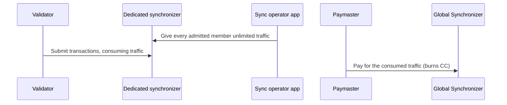

On a registered dedicated synchronizer, members do not buy traffic. The synchronizer's operator gives every member unlimited traffic, and one party, the paymaster, pays for the traffic the synchronizer uses with Canton Coin (CC) on the Global Synchronizer. This page explains how that works, how a validator joins such a synchronizer and how the paymaster pays. To run such a synchronizer, see [Dedicated Synchronizer Helm Deployment](/global-synchronizer/extension-synchronizers/dedicated-synchronizer-deployment).

## How it works

1. **Registration.** The Super Validators (SVs) register the dedicated synchronizer by a governance vote. The vote creates a `RegisteredSynchronizer` contract on the Global Synchronizer that binds the synchronizer ID to the paymaster's party and sets the highest activity weights its purchases may state.
2. **Unlimited traffic.** The operator's sync operator app gives every participant the operator has admitted, and the synchronizer's mediators, unlimited traffic on the dedicated synchronizer's sequencer.
3. **Use.** Participants submit transactions on the dedicated synchronizer, and the sequencer records the traffic each of them consumes.
4. **Payment.** The paymaster pays for the consumed traffic. The purchase is a Global Synchronizer transaction that burns CC like any other [traffic purchase](/global-synchronizer/deployment/synchronizer-traffic), with the registration attached. The `MemberTraffic` contract that records it names the synchronizer and no member.



Only the registered paymaster can pay for the synchronizer. A purchase for a synchronizer that is not registered is refused.

## Price

Traffic for a registered dedicated synchronizer costs the Global Synchronizer's price, `extraTrafficPrice` in the [traffic parameters](/global-synchronizer/deployment/synchronizer-traffic#traffic-parameters). For example, at 60 USD per MB, 60 USD of CC pays for 1 MB.

Every purchase must be for at least the Global Synchronizer's `minTopupAmount`.

## Traffic parameters

The operator's sync operator app keeps these traffic parameters on the dedicated synchronizer:

- **No free traffic.** The base traffic amount is zero, so all the traffic charged to a member counts as consumed traffic. That includes topology transactions such as party allocations and package vetting.
- **The Global Synchronizer's read cost.** The read versus write scaling factor is 4 by default, chosen to match the Global Synchronizer's `readVsWriteScalingFactor`. The app takes it from its own configuration, not from the Global Synchronizer.
- **Free confirmation responses.** Confirmation responses are not charged.

Members have unlimited traffic, so these parameters set how much traffic a message is charged, not whether a member can send it. Otherwise, [traffic accounting](/global-synchronizer/deployment/synchronizer-traffic#traffic-accounting-what-counts-as-traffic) works as on the Global Synchronizer.

## Join a dedicated synchronizer

The operator admits only participants it has permissioned, and gives each of them unlimited traffic before it connects. A validator joins in this order:

1. **Ask the operator for access.** Send your participant ID, which `participant.id.toProtoPrimitive` prints in your participant's [Canton console](/global-synchronizer/reference/canton-console-reference#participant-console). The operator admits your participant and sends you the URL of the synchronizer's sequencer.
2. **Connect.** Add the synchronizer to your validator's configuration. With the `splice-validator` Helm chart, add it to `extraDomains` and upgrade the release:

   ```yaml
   extraDomains:
     - alias: "dedicated"
       url: "https://sequencer.dedicated.example.com"
   ```

   Otherwise, set the same in the validator app's configuration, for example through an [`ADDITIONAL_CONFIG` environment variable](/global-synchronizer/deployment/configuration#adding-ad-hoc-configuration):

   ```
   canton.validator-apps.validator_backend.domains.extra = [{
     alias = "dedicated"
     url = "https://sequencer.dedicated.example.com"
   }]
   ```

   The validator app connects the participant to every synchronizer in this list as part of starting up, and does not start if one of them refuses the participant. Add the synchronizer only after the operator has admitted your participant.

Your participant needs no traffic purchase and no CC for the dedicated synchronizer. Once connected, read its traffic there in its console:

```scala
participant.traffic_control.traffic_state(participant.synchronizers.id_of("dedicated"))
```

`extraTrafficPurchased` is your participant's limit, 9223372036854775807 for unlimited traffic, and `extraTrafficConsumed` is the traffic it has used.

The validator app applies the configured `url` to the participant's connection each time it starts. Two consequences:

- After the operator [upgrades the synchronizer](/global-synchronizer/extension-synchronizers/dedicated-synchronizer-upgrades), your participant moves to the new sequencer by itself, but change `url` to the new URL the operator sends you, or the next restart points it back at the old one.
- An entry holds one sequencer URL. On a synchronizer that runs several sequencers, it replaces a connection to several of them with a connection to one.

## Pay for traffic

The paymaster pays for the traffic that the synchronizer's participants have consumed, with CC it holds on the Global Synchronizer. The operator reads the consumption on its sequencer, as described in [Monitor traffic](/global-synchronizer/extension-synchronizers/dedicated-synchronizer-operations#monitor-traffic). Nothing on the ledger checks the amount paid against the consumption.

A purchase is a transaction on the Global Synchronizer, so the paymaster needs no connection to the dedicated synchronizer. It is either a token standard transfer or a direct exercise of the purchase choice.

### Pay with a token standard transfer

The paymaster buys traffic with a token standard (V1 or V2) CC transfer to the traffic purchase party. It works like a [traffic purchase](/global-synchronizer/deployment/synchronizer-traffic) for the Global Synchronizer, with a memo that names no member. The paymaster creates the transfer with these values:

- **Sender:** the paymaster.
- **Receiver:** the traffic purchase party `splice_traffic-manager::1220000000000000000000000000000000000000000000000000000000000000abcd`.
- **Amount:** the total amount of CC to spend on traffic.
- **Memo:** the `splice.lfdecentralizedtrust.org/reason` metadata value, in this format:

  ```text
  splice/memo:synchronizer-id=<synchronizer>&migration-id=0
  ```

  - `synchronizer-id` (required): the ID of the dedicated synchronizer.
  - `migration-id` (required): `0`.
  - `app-activity-weight` and `asset-activity-weight` (optional): the purchase's [activity weights](#activity-weights).
  - `forfeit-validator-reward-coupon` (optional): `true` or `false`. The default is `false`. As for any traffic purchase, the transfer creates a validator reward coupon unless this is `true`.

  The memo has no `member-id`, since the paymaster pays for the synchronizer as a whole.

Scan's transfer factory adds the synchronizer's registration to the choice context of such a transfer. The transfer completes immediately and burns the full amount. The purchased traffic in bytes is rounded down:

```text
bytes = floor(CC amount × CC price × 1,000,000 / extraTrafficPrice)
```

### Pay with a direct purchase

The paymaster's own app or automation can exercise `AmuletRules_BuyMemberTraffic` instead, with these arguments:

- `provider`: the paymaster.
- `synchronizerId`: the ID of the dedicated synchronizer.
- `memberId`: empty.
- `migrationId`: `0`.
- `trafficAmount`: the traffic to pay for, in bytes.
- `optDSyncTrafficPurchase`: the contract ID of the synchronizer's `RegisteredSynchronizer` contract as `registeredSynchronizerCid`, and the purchase's [activity weights](#activity-weights) as `optAppActivityWeight` and `optAssetActivityWeight`, which can both be left empty.

The paymaster is an observer of the `RegisteredSynchronizer` contract, so it reads the contract from its own participant. The remaining arguments are those of any traffic purchase.

### Activity weights

A purchase has an app activity weight and an asset activity weight. Each is at least 0 and at most the maximum that the SVs set in the registration, and defaults to that maximum when the purchase leaves it out. A purchase checks its weights against the registration and records no app or asset activity for the paymaster.

### Refused purchases

A purchase fails, and burns no CC, if:

- the sender or `provider` is not the registration's paymaster (error code: `splice.lfdecentralizedtrust.org/not-paymaster`),
- the synchronizer is not registered, or a direct purchase leaves out the registration (error code: `splice.lfdecentralizedtrust.org/unknown-synchronizer`),
- the registration is for another synchronizer than the purchase names (error code: `splice.lfdecentralizedtrust.org/registered-synchronizer-mismatch`),
- the registration is for one of the Global Synchronizer's `requiredSynchronizers` (error code: `splice.lfdecentralizedtrust.org/registered-required-synchronizer`),
- the purchase names a member (error code: `splice.lfdecentralizedtrust.org/invalid-member-id`),
- the migration ID is not 0 (error code: `splice.lfdecentralizedtrust.org/invalid-migration-id`),
- an activity weight is below 0 or above the registration's maximum (error code: `splice.lfdecentralizedtrust.org/invalid-activity-weight`),
- a transfer's memo gives activity weights for a synchronizer that is not registered (error code: `splice.lfdecentralizedtrust.org/activity-weight-without-registration`), or
- the purchased traffic is less than `minTopupAmount` (error code: `splice.lfdecentralizedtrust.org/insufficient-topup-amount`).

After the SVs offboard the synchronizer, its registration is archived and every purchase for it fails.

## Trust

The dedicated synchronizer's sequencer applies whatever traffic limit the operator sets, and members get unlimited traffic whether or not the paymaster has paid. Nothing on the ledger checks the paymaster's purchases against the traffic the synchronizer used. The SVs can offboard a synchronizer whose paymaster does not pay.
