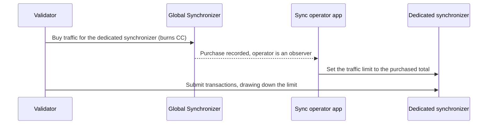

<div className="todo">

Draft for ChainSafe/canton-extending-mainnet#37. Describes the Splice release that ships the sync operator app; confirm that release, and check every claim against it, before publishing.

</div>

A dedicated synchronizer can charge for traffic the way the Global Synchronizer does. Its members buy traffic for it with Canton Coin (CC) on the Global Synchronizer, and the synchronizer's operator grants that traffic on its own sequencer. This page explains how that works and how a validator buys traffic for a dedicated synchronizer. To run such a synchronizer, see [Sync Operator](/global-synchronizer/extension-synchronizers/sync-operator).

## How it works

1. **Registration.** The Super Validators (SVs) register the dedicated synchronizer by a governance vote. The vote creates a `RegisteredSynchronizer` contract on the Global Synchronizer that binds the synchronizer ID to the operator's party and sets a traffic discount.
2. **Purchase.** A validator buys traffic for its participant on the dedicated synchronizer. The purchase is a Global Synchronizer transaction that burns CC like any other [traffic purchase](/global-synchronizer/deployment/synchronizer-traffic), with the registration attached. The `MemberTraffic` contract that records it names the operator as an observer.
3. **Grant.** The operator's sync operator app sees the purchase and raises the participant's traffic limit on the dedicated synchronizer's sequencer to the participant's total purchased traffic.
4. **Use.** The participant submits transactions on the dedicated synchronizer, and the sequencer deducts traffic from that limit.



A purchase for a synchronizer that is not registered is refused.

## Price

Traffic on a registered dedicated synchronizer costs the Global Synchronizer's price, `extraTrafficPrice` in the [traffic parameters](/global-synchronizer/deployment/synchronizer-traffic#traffic-parameters), times the registration's discount factor. The factor is greater than 0 and at most 1, where 1 is the full price. For example, at 60 USD per MB and a factor of 0.5, 60 USD of CC buys 2 MB.

Every purchase must be at least the Global Synchronizer's `minTopupAmount`. The SVs set the discount factor when they register the synchronizer and can change it by a later vote.

## Traffic parameters

The operator's sync operator app keeps these traffic parameters on the dedicated synchronizer:

- **No free traffic.** The base traffic amount is zero, so a participant can only send what it has bought. That includes topology transactions such as party allocations and package vetting.
- **The Global Synchronizer's read cost.** The read versus write scaling factor follows the Global Synchronizer's `readVsWriteScalingFactor`.
- **Free confirmation responses.** Confirmation responses are not charged.

The operator's mediators have unlimited traffic, since they cannot buy any. Otherwise, [traffic accounting](/global-synchronizer/deployment/synchronizer-traffic#traffic-accounting-what-counts-as-traffic) works as on the Global Synchronizer.

## Join a dedicated synchronizer

A registered dedicated synchronizer is permissioned, and a new member has no traffic on it. Connecting already costs traffic, because the participant sends its parties and package vetting to the synchronizer when it connects. So a validator joins in this order:

1. **Ask the operator for access.** Send your participant ID to the operator. The operator permissions it and sends you the URL of the synchronizer's sequencer.
2. **Register the connection.** Register the synchronizer with a handshake but do not connect yet. The handshake makes your participant a member of the synchronizer and costs no traffic. For example, in the Canton console:

   ```scala
   participant.synchronizers.register_by_config(
     SynchronizerConnectionConfig.tryGrpcSingleConnection(
       "dedicated",
       SequencerAlias.Default,
       "https://sequencer.dedicated.example.com",
     )
   )
   ```

3. **Buy traffic** for your participant on the synchronizer, as described in [Buy traffic manually](#buy-traffic-manually).
4. **Connect** once the operator has granted the purchase:

   ```scala
   participant.synchronizers.reconnect("dedicated")
   ```

   To stay connected and topped up, add the synchronizer to your validator's configuration as shown in [Automatic top-ups](#automatic-top-ups).

<div className="todo">

Simplify once a purchase made before a participant joins is granted when it joins (ChainSafe/canton-extending-mainnet#116, canton-network/splice-multi-sync#71); the order then becomes buy, then connect. Confirm whether a validator that lists the synchronizer in `domains.extra` before it has traffic there blocks at startup, since the validator app connects to every synchronizer in `domains.extra` when it starts. Run both console snippets against the release.

</div>

## Buy traffic

### Automatic top-ups

The validator app's [automatic top-ups](/global-synchronizer/deployment/validator-kubernetes#configuring-automatic-traffic-purchases) work for dedicated synchronizers too, with the same `targetThroughput` and `minTopupInterval` settings, set per synchronizer. The validator reads the synchronizer's registration from Scan for each top-up and skips the top-up while Scan has none. The CC comes from the validator's wallet, as for the Global Synchronizer.

With the `splice-validator` Helm chart, set them on the synchronizer's entry in `extraDomains`:

```yaml
extraDomains:
  - alias: "dedicated"
    url: "https://sequencer.dedicated.example.com"
    topup:
      targetThroughput: 20000
      minTopupInterval: "1m"
```

Otherwise, set the same in the validator app's configuration, for example through an [`ADDITIONAL_CONFIG` environment variable](/global-synchronizer/deployment/configuration#adding-ad-hoc-configuration):

```
canton.validator-apps.validator_backend.domains.extra = [{
  alias = "dedicated"
  url = "https://sequencer.dedicated.example.com"
  topup {
    target-throughput = 20000
    min-topup-interval = 1m
  }
}]
```

The validator app connects to every synchronizer in `extraDomains` when it starts.

### Buy traffic manually

To buy traffic once, send a [buy traffic request](/reference/splice-wallet-api-external/post-v0walletbuy-traffic-requests) to the wallet API with `domain_id` set to the dedicated synchronizer's ID and `receiving_validator_party_id` set to a party hosted on the participant that should receive the traffic.

To check that a synchronizer is registered, look up its registration on Scan at `GET /v0/synchronizers/{synchronizer_id}/registration`, or through your validator's scan proxy at `GET /v0/scan-proxy/synchronizers/{synchronizer_id}/registration`. Both return 404 for a synchronizer that is not registered.

### Check your traffic

Read your participant's traffic on the dedicated synchronizer from the participant itself, for example with `participant.traffic_control.traffic_state(synchronizerId)` in the Canton console. Scan's member traffic status endpoint serves the Global Synchronizer only and rejects a dedicated synchronizer's ID.

## When the Global Synchronizer is unavailable

Purchases are Global Synchronizer transactions, so while the Global Synchronizer is unavailable nobody can buy traffic for a dedicated synchronizer. A participant keeps transacting on what it has already bought, which with automatic top-ups is about one top-up.

To hold out longer, keep more traffic in reserve by making each top-up larger while the interval stays short. For example, to hold about a day, set `minTopupInterval` to one hour and `targetThroughput` to 24 times your actual rate. Your wallet then needs a day's traffic in CC at each top-up, since the funds check prices the whole amount.

The operator can also set an outage traffic allowance that lets participants keep transacting past what they have bought; see [Ride out a Global Synchronizer outage](/global-synchronizer/extension-synchronizers/sync-operator#ride-out-a-global-synchronizer-outage). Once the Global Synchronizer is back and the operator removes the allowance, a participant that used it is refused until its purchases cover what it used. Its next top-up buys that shortfall together with a normal top-up if its wallet covers both.

<div className="todo">

The outage allowance and the shortfall top-up are not released yet (canton-network/splice-multi-sync#71 and #80, ChainSafe/canton-extending-mainnet#129). Remove the last paragraph if they miss the release.

</div>

## Trust

The dedicated synchronizer's sequencer applies whatever traffic limit the operator sets. Nothing checks those limits against what members bought, so members rely on the operator to grant the traffic they paid for.
