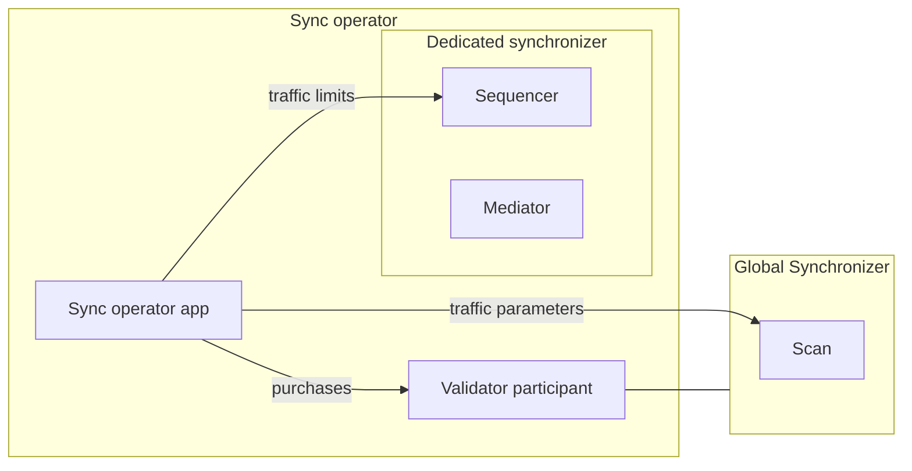

import ExternalCantonMainDocsOpenTargetSnippetJsonDataSynchronizerHowtosOperateBootstrap57 from "/snippets/external/canton/main/docs-open/target/snippet_json_data/synchronizer/howtos/operate/bootstrap-57.mdx";
import ExternalCantonMainDocsOpenTargetSnippetJsonDataSynchronizerHowtosOperateBootstrap58 from "/snippets/external/canton/main/docs-open/target/snippet_json_data/synchronizer/howtos/operate/bootstrap-58.mdx";
import ExternalCantonMainDocsOpenTargetSnippetJsonDataSynchronizerHowtosOperateBootstrap59 from "/snippets/external/canton/main/docs-open/target/snippet_json_data/synchronizer/howtos/operate/bootstrap-59.mdx";

<div className="todo">

Draft for ChainSafe/canton-extending-mainnet#37, with the admission write-up for #127, the outage runbook for #129 and the trust statement from #140. Describes the Splice release that ships the sync operator app and the `splice-sync-operator` chart; confirm that release, and check every claim against it, before publishing.

</div>

The sync operator is the organization that runs a dedicated synchronizer whose members [buy traffic with Canton Coin](/global-synchronizer/extension-synchronizers/dedicated-synchronizer-traffic). It runs the synchronizer, grants members the traffic they buy and admits new members. This page covers setting that up and running it.

## Components

A sync operator runs:

- **The dedicated synchronizer's sequencer and mediator**, configured and bootstrapped as described in [Synchronizer Operations](/global-synchronizer/extension-synchronizers/synchronizer-operations). Traffic management needs a BFT sequencer.
- **A validator** on the Global Synchronizer. Its participant hosts the operator party, which observes every traffic purchase for the synchronizer.
- **The sync operator app.** It reads those purchases through the participant's Ledger API, reads the Global Synchronizer's traffic parameters from Scan, and sets traffic limits and parameters through the sequencer's Admin API.



The sync operator app does not create the synchronizer. It serves the synchronizer that its configured sequencer belongs to.

## Set up

Set up runs in this order: create the operator party, bootstrap the synchronizer, deploy the sync operator app, then register the synchronizer.

### Create the operator party

The operator party is a party on your validator's participant, and the sync operator app acts as a Ledger API user whose primary party it is. Create both with an app instance on your validator. With the `splice-validator` Helm chart, add it through [ad-hoc configuration](/global-synchronizer/deployment/configuration#adding-ad-hoc-configuration):

```yaml
additionalEnvVars:
  - name: ADDITIONAL_CONFIG_SYNC_OPERATOR_APP_INSTANCE
    value: |
      canton.validator-apps.validator_backend.app-instances.syncOperator {
        service-user = "SYNC_OPERATOR_LEDGER_API_USER"
        dars = []
      }
```

Replace `SYNC_OPERATOR_LEDGER_API_USER` with the user ID your IAM issues to the sync operator app, the same value as `ledger-api-user` in its [auth secret](#deploy-the-sync-operator-app). Once the validator has restarted, read the party ID in the Canton console:

```scala
participant.ledger_api.users.get("SYNC_OPERATOR_LEDGER_API_USER").primaryParty
```

### Bootstrap the synchronizer

1. [Bootstrap the synchronizer](/global-synchronizer/extension-synchronizers/synchronizer-operations#bootstrap-a-synchronizer) and connect the participants that should be members from the start.
2. Make it [permissioned](/global-synchronizer/extension-synchronizers/synchronizer-operations#bootstrap-a-permissioned-synchronizer). Permission those participants first, then set `onboardingRestriction` to `RestrictedOpen`: the restriction deactivates every participant without a permission, including connected ones.
3. [Enable traffic management](/global-synchronizer/extension-synchronizers/synchronizer-operations#enable-traffic-management-on-a-synchronizer) with no base traffic, so participants can only use traffic they buy:

```scala
import com.digitalasset.canton.config.RequireTypes.{NonNegativeNumeric, PositiveNumeric}
import com.digitalasset.canton.config.PositiveFiniteDuration
import com.digitalasset.canton.admin.api.client.data.TrafficControlParameters
val trafficControlParameters = TrafficControlParameters(
  enforceRateLimiting = true,
  maxBaseTrafficAmount = NonNegativeNumeric.tryCreate(0L),
  readVsWriteScalingFactor = PositiveNumeric.tryCreate(200),
  maxBaseTrafficAccumulationDuration = PositiveFiniteDuration.ofMinutes(10L),
  setBalanceRequestSubmissionWindowSize = PositiveFiniteDuration.ofMinutes(5L),
  baseEventCost = NonNegativeNumeric.tryCreate(0L),
  freeConfirmationResponses = false,
)
sequencer1.topology.synchronizer_parameters.propose_update(
  synchronizerId = sequencer1.synchronizer_id,
  _.update(trafficControl = Some(trafficControlParameters)),
)
```

The sync operator app then keeps the base traffic at zero, matches `readVsWriteScalingFactor` to the Global Synchronizer's and turns on free confirmation responses. It never turns traffic management on by itself, and waits at startup until it is on.

Deploy the sync operator app right after this step. Until it runs, the mediator has no traffic either, so transactions on the synchronizer fail.

### Deploy the sync operator app

The sync operator app ships as the `splice-sync-operator` Helm chart. Install it in your validator's namespace, so it reaches the participant and Postgres under their default names, `participant` and `postgres`. It uses the `postgres-secrets` secret your validator uses and creates its own database.

Create a Ledger API auth secret for the operator user, the same way as the validator's:

```bash
kubectl create --namespace validator secret generic splice-app-sync-operator-ledger-api-auth \
    "--from-literal=ledger-api-user=${SYNC_OPERATOR_CLIENT_ID}@clients" \
    "--from-literal=url=${OIDC_AUTHORITY_URL}/.well-known/openid-configuration" \
    "--from-literal=client-id=${SYNC_OPERATOR_CLIENT_ID}" \
    "--from-literal=client-secret=${SYNC_OPERATOR_CLIENT_SECRET}" \
    "--from-literal=audience=${OIDC_AUTHORITY_LEDGER_API_AUDIENCE}" \
    "--from-literal=scope=${OIDC_AUTHORITY_LEDGER_API_SCOPE}"
```

Create `sync-operator-values.yaml`:

```yaml
# A Scan you host or trust, as for your validator
scanAddress: "TRUSTED_SCAN_URL"
# The dedicated synchronizer's sequencer
sequencerAddress: "SEQUENCER_ADDRESS"
metrics:
  enable: true
```

The app reaches the sequencer's Admin API on port 5009 and the participant's Ledger API and Admin API on ports 5001 and 5002, the ports the Splice charts use. Install the chart:

```bash
helm install sync-operator oci://ghcr.io/digital-asset/decentralized-canton-sync/helm/splice-sync-operator -n validator --version ${CHART_VERSION} -f sync-operator-values.yaml --wait
```

The app reports ready on `/api/syncoperator/readyz`, port 5016, once it has reached the participant, Scan and the sequencer and found traffic management on. From then on it:

- keeps the base traffic at zero, the read versus write scaling factor at the Global Synchronizer's, and confirmation responses free;
- gives the synchronizer's mediators unlimited traffic, since they cannot buy any;
- sets each member's traffic limit on the sequencer to its total purchased traffic whenever a purchase lands.

<div className="todo">

Document the sequencer and mediator deployment once the chart for them is settled; the local run used the `splice-global-domain` chart with `sequencer.driver.type=cantonbft`, which needs automatic node initialization added through `additionalEnvVars`.

</div>

### Register the synchronizer

The SVs register the synchronizer by a governance vote. Send them:

- the synchronizer ID, as `name::fingerprint`, which `sequencer1.synchronizer_id` prints in the Canton console;
- the operator party ID from [Create the operator party](#create-the-operator-party);
- the traffic discount you have agreed with them, if any.

An SV proposes the vote as described in [Registering a dedicated synchronizer](/global-synchronizer/deployment/sv-operations#registering-a-dedicated-synchronizer). Once it passes, Scan serves the registration:

```bash
curl "${TRUSTED_SCAN_URL}/api/scan/v0/synchronizers/${SYNCHRONIZER_ID}/registration"
```

From then on, validators can buy traffic for the synchronizer, and the app grants it. The registration fixes the operator party: a different operator needs a new synchronizer and a new registration. The SVs can change the discount, or offboard the synchronizer, by later votes. After an offboarding, purchases for it are refused.

## Admit a validator

The synchronizer admits only participants its owners have permissioned. To admit a validator:

1. The validator sends you its participant ID:

<ExternalCantonMainDocsOpenTargetSnippetJsonDataSynchronizerHowtosOperateBootstrap57 />

2. Import it on the node that holds the synchronizer's owner key, the sequencer if you bootstrapped with the sequencer as owner:

<ExternalCantonMainDocsOpenTargetSnippetJsonDataSynchronizerHowtosOperateBootstrap58 />

3. Permission it from that node. On a synchronizer with several owners, enough owners to reach the threshold must do this:

<ExternalCantonMainDocsOpenTargetSnippetJsonDataSynchronizerHowtosOperateBootstrap59 />

4. Send the validator the URL of the sequencer's public API. It then joins as described in [Join a dedicated synchronizer](/global-synchronizer/extension-synchronizers/dedicated-synchronizer-traffic#join-a-dedicated-synchronizer).

The new member starts with no traffic. It can transact once it has bought traffic and the app has granted it.

## Monitor the traffic path

The sync operator app exposes [metrics](/global-synchronizer/production-operations/splice-metrics-overview) on port 10013 like the other Splice apps; `metrics.enable` creates a `ServiceMonitor` for them. These show whether purchases reach the sequencer:

- **Grants.** The reconcile trigger, `trigger_name="ReconcileDedicatedSequencerTrafficTrigger"`, reports `splice_trigger_latency_duration_seconds` for how long a grant takes and `splice_trigger_completed_total` for grants by `outcome`. The Automations dashboard shows both, and the Automation Failures alert fires when grants fail.
- **Member traffic.** On the sequencer, `daml_sequencer_traffic_control_extra_traffic_purchased` per `member` is the limit the app has set, and `daml_sequencer_traffic_control_extra_traffic_consumed` is what the member has used. The Synchronizer Fees (SV View) dashboard shows both.

<div className="todo">

The issue also asks for the trigger's iteration metric, `splice_trigger_iterations_total`. Only polling triggers report it, so it applies once the reconcile trigger polls (canton-network/splice-multi-sync#71). Decide where sync operators get the dashboards: the validator bundle does not carry Synchronizer Fees (SV View).

</div>

## Trust

The sequencer applies whatever traffic limit the operator sets. Nothing checks the operator's grants against purchases, so members trust the operator to grant what they paid for, and an operator could grant traffic nobody paid for. The [outage traffic allowance](#ride-out-a-global-synchronizer-outage) is the one case where the sync operator app itself grants past what was bought.

## Upgrade the synchronizer

The sync operator upgrades its synchronizer with a [logical synchronizer upgrade](/global-synchronizer/production-operations/logical-synchronizer-upgrade) on its own schedule, without an SV vote. Purchased traffic carries over to the successor.

1. Deploy the successor sequencer and mediator next to the current ones.
2. Add them to the sync operator app's configuration under `synchronizer-nodes.successor`: the sequencer's Admin API, its `internal-api` for the mediator and its `external-public-api-url` for participants, the mediator's Admin API, and the successor's `protocol-version` and `serial`. Add the current mediator's Admin API under `synchronizer-nodes.current.mediator`. Set `lsu-dump-path`, where the app writes the current synchronizer's state, and the schedule under `lsu`: `topology-freeze-time`, `upgrade-time`, `new-physical-synchronizer-serial` and `new-physical-synchronizer-protocol-version`. Restart the app.
3. At the topology freeze time the app announces the upgrade and prepares the successor nodes. At the upgrade time participants move to the successor, and the app transfers the traffic state to it.
4. Once the upgrade is done, point `synchronizer-nodes.current` at the successor nodes and remove `successor` and `lsu`.

<div className="todo">

Add a tested configuration example and say how to cancel a scheduled upgrade; the operator has no equivalent of the SV cancel endpoint (ChainSafe/canton-extending-mainnet#36).

</div>

## Ride out a Global Synchronizer outage

<div className="todo">

Requires the outage traffic allowance, canton-network/splice-multi-sync#71 and #80 (ChainSafe/canton-extending-mainnet#129). Do not publish before it ships.

</div>

While the Global Synchronizer is unavailable, nobody can buy traffic, and each member runs only on what it bought before. To keep members transacting, set an outage traffic allowance: bytes each participant may use past what it has bought.

- **Setting it.** Add `outage-traffic-allowance`, in bytes per participant, to the sync operator app's configuration and restart the app. The app only starts once its Scan is reachable. Each participant's limit becomes its purchased total, or 0 if it has none, plus the allowance. That includes participants that join while it is set, so keep onboarding restricted. Size it from the members' traffic rates and how long the outage may last: your exposure is the allowance times the number of participants. Setting a smaller value and restarting lowers the limits again.
- **While it is set.** Each participant keeps the full allowance on top of what it has bought, including purchases made once the Global Synchronizer is back. The app does not warn while it is set, so watching for the Global Synchronizer's return is up to you.
- **Removing it.** Once the Global Synchronizer is back, remove the setting and restart the app, optionally after a grace period so members can buy back what they used before their limits drop. Each limit goes back to the purchased total. A participant that used the allowance is refused until its purchases cover what it used.
- **Several organizations.** Every operator sets, and later removes, the same value at about the same time. Nothing changes until a threshold of operators agree.

With the `splice-sync-operator` chart, set it through ad-hoc configuration:

```yaml
additionalEnvVars:
  - name: ADDITIONAL_CONFIG_OUTAGE_TRAFFIC_ALLOWANCE
    value: canton.sync-operator-apps.sync-operator.outage-traffic-allowance = 50000000
```

Members can also hold more traffic in reserve; see [When the Global Synchronizer is unavailable](/global-synchronizer/extension-synchronizers/dedicated-synchronizer-traffic#when-the-global-synchronizer-is-unavailable).

## Run the synchronizer with several operators

A dedicated synchronizer can be run by several organizations, each with its own sequencer and mediator, as a [decentralized synchronizer](/global-synchronizer/extension-synchronizers/synchronizer-operations#set-up-a-decentralized-synchronizer). Each organization runs its own sync operator app against its own sequencer. A traffic limit only changes once a threshold of sequencers, the `threshold` of the `SequencerSynchronizerState` mapping, has submitted the same value, so every operator must run the app.

<div className="todo">

ChainSafe/canton-extending-mainnet#106: settle with DA how the registered operator party is shared across organizations, which keys own the synchronizer, and who leads upgrades. Then document the layout and bootstrap.

</div>

## Bring an existing synchronizer onto paid traffic

A dedicated synchronizer that already runs without paid traffic can move onto it in place. Follow this order so no member loses access at the switch:

1. Register the synchronizer by vote, as in [Register the synchronizer](#register-the-synchronizer).
2. Restrict onboarding, permissioning the participants already connected first.
3. Have every member buy traffic for the synchronizer.
4. Switch to paid traffic last, since that is the step that stops anyone without purchased traffic.

<div className="todo">

ChainSafe/canton-extending-mainnet#100: spell out step 4 with the sync operator app, which sets the base traffic to zero as soon as it starts. Decide the case where members have already used more traffic than any purchase covers, then test the migration.

</div>
