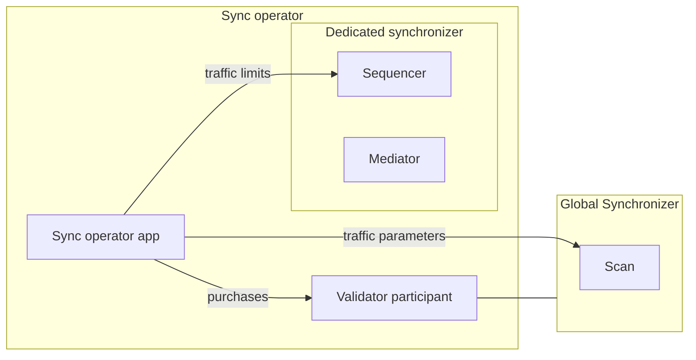

import ExternalCantonMainDocsOpenTargetSnippetJsonDataSynchronizerHowtosOperateBootstrap57 from "/snippets/external/canton/main/docs-open/target/snippet_json_data/synchronizer/howtos/operate/bootstrap-57.mdx";
import ExternalCantonMainDocsOpenTargetSnippetJsonDataSynchronizerHowtosOperateBootstrap58 from "/snippets/external/canton/main/docs-open/target/snippet_json_data/synchronizer/howtos/operate/bootstrap-58.mdx";
import ExternalCantonMainDocsOpenTargetSnippetJsonDataSynchronizerHowtosOperateBootstrap59 from "/snippets/external/canton/main/docs-open/target/snippet_json_data/synchronizer/howtos/operate/bootstrap-59.mdx";

<div className="todo">

Runbook for ChainSafe/canton-extending-mainnet#37, with the admission write-up for #127, the outage runbook for #129, the trust statement from #140, the upgrade runbook for #36, the multi-node layout for #106 and the migration for #100. Describes the Splice release that ships the sync operator app and the `splice-sync-operator` chart; confirm that release before publishing.

</div>

The sync operator is the organization that runs a dedicated synchronizer whose members [buy traffic with Canton Coin](/global-synchronizer/extension-synchronizers/dedicated-synchronizer-traffic). This page is its runbook: deploying the synchronizer and the sync operator app with Helm, registering the synchronizer, admitting validators, and running it day to day.

## Components

A sync operator runs:

- **The dedicated synchronizer's sequencer and mediator**, from the `splice-global-domain` chart that SVs use for their nodes.
- **A validator** on the Global Synchronizer. Its participant hosts the operator party, which observes every traffic purchase for the synchronizer.
- **The sync operator app.** It reads those purchases through the participant's Ledger API, reads the Global Synchronizer's traffic parameters from Scan, and sets traffic limits and parameters through the sequencer's Admin API.



The sync operator app does not create the synchronizer. It serves the synchronizer that its configured sequencer belongs to.

## Before you start

- Deploy a validator as described in [Kubernetes Validator Deployment](/global-synchronizer/deployment/validator-kubernetes), in the `validator` namespace. This runbook installs everything else into the same namespace.
- Use the same `CHART_VERSION` and release bundle (`splice-node`) as for the validator.
- Create a client for the sync operator app in your IAM, the way you did for the validator app, and export its ID and secret as `SYNC_OPERATOR_CLIENT_ID` and `SYNC_OPERATOR_CLIENT_SECRET`.

## Set up

Set up runs in this order: create the operator party, deploy the synchronizer's nodes, bootstrap the synchronizer, deploy the sync operator app, then register the synchronizer.

### Create the operator party

The operator party is a party on your validator's participant, and the sync operator app acts as a Ledger API user whose primary party it is. Have your validator create both as an app instance, through [ad-hoc configuration](/global-synchronizer/deployment/configuration#adding-ad-hoc-configuration) in its Helm values:

```yaml
additionalEnvVars:
  - name: ADDITIONAL_CONFIG_SYNC_OPERATOR_APP_INSTANCE
    value: |
      canton.validator-apps.validator_backend.app-instances.syncOperator {
        service-user = "SYNC_OPERATOR_LEDGER_API_USER"
        dars = []
      }
```

Replace `SYNC_OPERATOR_LEDGER_API_USER` with the user ID your IAM issues to the sync operator app, the same value as `ledger-api-user` in its [auth secret](#deploy-the-sync-operator-app), for example `${SYNC_OPERATOR_CLIENT_ID}@clients`. Upgrade the validator release with the new values. The validator logs the party it allocated:

```bash
kubectl logs -n validator deployment/validator-app | grep 'Setup app syncOperator'
```

The `primary party` in that line is the operator party.

### Deploy the synchronizer's nodes

The sequencer and the mediator each use their own Postgres instance, as in the [SV deployment](/global-synchronizer/deployment/kubernetes-deployment). Create their password secrets and install them:

```bash
kubectl create secret generic sequencer-pg-secret \
    --from-literal=postgresPassword=${POSTGRES_PASSWORD_SEQUENCER} \
    -n validator
kubectl create secret generic mediator-pg-secret \
    --from-literal=postgresPassword=${POSTGRES_PASSWORD_MEDIATOR} \
    -n validator
helm install sequencer-pg oci://ghcr.io/digital-asset/decentralized-canton-sync/helm/splice-postgres -n validator --version ${CHART_VERSION} -f splice-node/examples/sv-helm/postgres-values-sequencer.yaml --wait
helm install mediator-pg oci://ghcr.io/digital-asset/decentralized-canton-sync/helm/splice-postgres -n validator --version ${CHART_VERSION} -f splice-node/examples/sv-helm/postgres-values-mediator.yaml --wait
```

Create `dedicated-sync-values.yaml`. The `0` in the names is the synchronizer's serial, which goes up with each [upgrade](#upgrade-the-synchronizer):

```yaml
sequencer:
  persistence:
    host: sequencer-pg
    port: 5432
    secretName: sequencer-pg-secret
    databaseName: sequencer_0
  driver:
    type: "cantonbft"
    externalAddress: "dedicated-sync-0-sequencer"
    externalPort: 5010
    persistence:
      databaseName: sequencer_cantonbft_0
  additionalEnvVars:
    - name: ADDITIONAL_CONFIG_AUTO_INIT
      value: |
        canton.sequencers.sequencer.init {
          identity.type = auto
          generate-topology-transactions-and-keys = true
        }
mediator:
  persistence:
    host: mediator-pg
    port: 5432
    secretName: mediator-pg-secret
    databaseName: mediator_0
  additionalEnvVars:
    - name: ADDITIONAL_CONFIG_AUTO_INIT
      value: |
        canton.mediators.mediator.init {
          identity.type = auto
          generate-topology-transactions-and-keys = true
        }
```

The sequencer runs on the Canton BFT orderer, as a single node with its own database. The `ADDITIONAL_CONFIG_AUTO_INIT` entries let both nodes create their own identities: the images wait for an SV app to do that otherwise. Install the chart:

```bash
helm install dedicated-sync-0 oci://ghcr.io/digital-asset/decentralized-canton-sync/helm/splice-global-domain -n validator --version ${CHART_VERSION} -f dedicated-sync-values.yaml --wait
```

This creates the services `dedicated-sync-0-sequencer`, with the public API on port 5008 and the Admin API on 5009, and `dedicated-sync-0-mediator`, with the Admin API on 5007. Expose the sequencer's public API to the validators that will join, for example through your ingress. Its URL is what you send them.

### Bootstrap the synchronizer

Bootstrap the synchronizer once, from a Canton console that reaches both nodes. Open one on the sequencer pod as described in [Access in a K8s cluster](/global-synchronizer/reference/canton-console-reference#access-in-a-k8s-cluster), with this `console.conf`:

```
canton {
  remote-sequencers {
    sequencer {
      public-api {
        address = dedicated-sync-0-sequencer
        port = 5008
      }
      admin-api {
        address = dedicated-sync-0-sequencer
        port = 5009
      }
    }
  }
  remote-mediators {
    mediator {
      admin-api {
        address = dedicated-sync-0-mediator
        port = 5007
      }
    }
  }
  features.enable-preview-commands = yes
}
```

Then run the following. It bootstraps the synchronizer with the sequencer as its owner, restricts onboarding to participants you permission, and turns on traffic management with no base traffic, last:

```scala
val synchronizerId = bootstrap.synchronizer(
  synchronizerName = "dedicated",
  sequencers = Seq(sequencer),
  mediators = Seq(mediator),
  synchronizerOwners = Seq(sequencer),
  synchronizerThreshold = PositiveInt.one,
  staticSynchronizerParameters = StaticSynchronizerParameters.defaultsWithoutKMS(ProtocolVersion.latest),
).logical

sequencer.topology.synchronizer_parameters.propose_update(
  synchronizerId,
  _.update(onboardingRestriction = OnboardingRestriction.RestrictedOpen),
  signedBy = Some(sequencer.id.uid.namespace.fingerprint),
)

sequencer.topology.synchronizer_parameters.propose_update(
  synchronizerId,
  _.update(trafficControl =
    Some(
      TrafficControlParameters(
        maxBaseTrafficAmount = NonNegativeLong.zero,
        readVsWriteScalingFactor = PositiveInt.tryCreate(200),
        maxBaseTrafficAccumulationDuration = PositiveFiniteDuration.ofMinutes(10),
        setBalanceRequestSubmissionWindowSize = PositiveFiniteDuration.ofMinutes(5),
        enforceRateLimiting = true,
        baseEventCost = NonNegativeLong.zero,
        freeConfirmationResponses = false,
      )
    )
  ),
  signedBy = Some(sequencer.id.uid.namespace.fingerprint),
)

utils.retry_until_true {
  val parameters =
    sequencer.topology.synchronizer_parameters.get_dynamic_synchronizer_parameters(synchronizerId)
  parameters.onboardingRestriction == OnboardingRestriction.RestrictedOpen &&
  parameters.trafficControl.isDefined
}

println(s"Synchronizer ID: ${sequencer.synchronizer_id}")
```

The last line prints the synchronizer ID, `dedicated::` followed by a fingerprint. You send it to the SVs and to the validators that join.

Deploy the sync operator app right after this step. Until it runs, the mediator has no traffic either, so transactions on the synchronizer fail. The app keeps the base traffic at zero, matches `readVsWriteScalingFactor` to the Global Synchronizer's and turns on free confirmation responses. It never turns traffic management on by itself, and waits at startup until it is on.

### Deploy the sync operator app

The sync operator app ships as the `splice-sync-operator` chart. In the `validator` namespace it reaches the participant and Postgres under their default names, `participant` and `postgres`, uses the `postgres-secrets` secret your validator uses, and creates its own database.

Create a Ledger API auth secret for the operator user, the same way as the validator's:

```bash
kubectl create --namespace validator secret generic splice-app-sync-operator-ledger-api-auth \
    "--from-literal=ledger-api-user=${SYNC_OPERATOR_CLIENT_ID}@clients" \
    "--from-literal=url=${OIDC_AUTHORITY_URL}/.well-known/openid-configuration" \
    "--from-literal=client-id=${SYNC_OPERATOR_CLIENT_ID}" \
    "--from-literal=client-secret=${SYNC_OPERATOR_CLIENT_SECRET}" \
    "--from-literal=audience=${OIDC_AUTHORITY_LEDGER_API_AUDIENCE}" \
    "--from-literal=scope=${OIDC_AUTHORITY_LEDGER_API_SCOPE}"
```

Create `sync-operator-values.yaml`:

```yaml
# A Scan you host or trust, as for your validator
scanAddress: "TRUSTED_SCAN_URL"
# The dedicated synchronizer's sequencer
sequencerAddress: "dedicated-sync-0-sequencer"
metrics:
  enable: true
```

The app reaches the sequencer's Admin API on port 5009 and the participant's Ledger API and Admin API on ports 5001 and 5002, the ports the Splice charts use. Install the chart:

```bash
helm install sync-operator oci://ghcr.io/digital-asset/decentralized-canton-sync/helm/splice-sync-operator -n validator --version ${CHART_VERSION} -f sync-operator-values.yaml --wait
```

The app reports ready on `/api/syncoperator/readyz`, port 5016, once it has reached the participant, Scan and the sequencer and found traffic management on. From then on it:

- keeps the base traffic at zero, the read versus write scaling factor at the Global Synchronizer's, and confirmation responses free;
- gives the synchronizer's mediators unlimited traffic, since they cannot buy any;
- sets each member's traffic limit on the sequencer to its total purchased traffic whenever a purchase lands.

### Register the synchronizer

The SVs register the synchronizer by a governance vote. Send them:

- the synchronizer ID from [Bootstrap the synchronizer](#bootstrap-the-synchronizer);
- the operator party ID from [Create the operator party](#create-the-operator-party);
- the traffic discount you have agreed with them, if any.

An SV proposes the vote as described in [Registering a dedicated synchronizer](/global-synchronizer/deployment/sv-operations#registering-a-dedicated-synchronizer). Once it passes, Scan serves the registration:

```bash
curl "${TRUSTED_SCAN_URL}/api/scan/v0/synchronizers/${SYNCHRONIZER_ID}/registration"
```

From then on, validators can buy traffic for the synchronizer, and the app grants it. The registration fixes the operator party: a different operator needs a new synchronizer and a new registration. The SVs can change the discount, or offboard the synchronizer, by later votes. After an offboarding, purchases for it are refused.

## Admit a validator

The synchronizer admits only participants its owner has permissioned. To admit a validator:

1. The validator sends you its participant ID:

<ExternalCantonMainDocsOpenTargetSnippetJsonDataSynchronizerHowtosOperateBootstrap57 />

2. Import it in your console on the sequencer, which holds the synchronizer's owner key:

<ExternalCantonMainDocsOpenTargetSnippetJsonDataSynchronizerHowtosOperateBootstrap58 />

3. Permission it from the sequencer. On a synchronizer with several owners, enough owners to reach the threshold must do this:

<ExternalCantonMainDocsOpenTargetSnippetJsonDataSynchronizerHowtosOperateBootstrap59 />

4. Send the validator the URL of the sequencer's public API and the synchronizer ID. It then joins as described in [Join a dedicated synchronizer](/global-synchronizer/extension-synchronizers/dedicated-synchronizer-traffic#join-a-dedicated-synchronizer).

The new member starts with no traffic. It can transact once it has bought traffic and the app has granted it.

## Monitor the traffic path

The sync operator app exposes [metrics](/global-synchronizer/production-operations/splice-metrics-overview) on port 10013 like the other Splice apps; `metrics.enable` creates a `ServiceMonitor` for them. These show whether purchases reach the sequencer:

- **Grants.** The reconcile trigger, `trigger_name="ReconcileDedicatedSequencerTrafficTrigger"`, reports `splice_trigger_latency_duration_seconds` for how long a grant takes and `splice_trigger_completed_total` for grants by `outcome`. The Automations dashboard shows both, and the Automation Failures alert fires when grants fail.
- **Member traffic.** On the sequencer, `daml_sequencer_traffic_control_extra_traffic_purchased` per `member` is the limit the app has set, and `daml_sequencer_traffic_control_extra_traffic_consumed` is what the member has used. The Synchronizer Fees (SV View) dashboard shows both.

Import the [Grafana dashboards](/global-synchronizer/production-operations/splice-metrics-overview#grafana-dashboards) from the release bundle: Automations from `validator-grafana-dashboards/`, and Synchronizer Fees (SV View) from `sv-grafana-dashboards/`.

## Trust

The sequencer applies whatever traffic limit the operator sets. Nothing checks the operator's grants against purchases, so members trust the operator to grant what they paid for, and an operator could grant traffic nobody paid for. The [outage traffic allowance](#ride-out-a-global-synchronizer-outage) is the one case where the sync operator app itself grants past what was bought.

## Upgrade the synchronizer

The sync operator upgrades its synchronizer with a [logical synchronizer upgrade](/global-synchronizer/production-operations/logical-synchronizer-upgrade) on its own schedule, without an SV vote. Participants move to the new nodes by themselves, and purchased traffic carries over.

1. **Deploy the successor nodes.** Install a second `splice-global-domain` release, `dedicated-sync-1`, from a copy of `dedicated-sync-values.yaml` with the serial in the database names and in `externalAddress` changed from `0` to `1`, and without the two `ADDITIONAL_CONFIG_AUTO_INIT` entries: the app initializes the successor nodes from the current ones. Expose its public API to the validators, as for the current nodes.
2. **Schedule the upgrade.** Create `sync-operator-lsu-values.yaml`. Pick a topology freeze time and an upgrade time, in UTC, for example `2026-11-20T10:00:00Z`: from the freeze time until the upgrade, no topology changes are possible, so you cannot admit validators. The new serial is the current one plus one. The protocol version can stay the same or go up:

   ```yaml
   # The app writes the current synchronizer's state here during the upgrade.
   pvc:
     size: 1Gi
     volumeStorageClass: standard-rwo
   additionalEnvVars:
     - name: ADDITIONAL_CONFIG_LSU
       value: |
         canton.sync-operator-apps.sync-operator {
           synchronizer-nodes {
             current.mediator.admin-api {
               address = "dedicated-sync-0-mediator"
               port = 5007
             }
             successor {
               sequencer {
                 admin-api {
                   address = "dedicated-sync-1-sequencer"
                   port = 5009
                 }
                 internal-api {
                   address = "dedicated-sync-1-sequencer"
                   port = 5008
                 }
                 external-public-api-url = "SUCCESSOR_SEQUENCER_PUBLIC_URL"
               }
               mediator.admin-api {
                 address = "dedicated-sync-1-mediator"
                 port = 5007
               }
               protocol-version = "NEW_PROTOCOL_VERSION"
               serial = 1
             }
           }
           lsu-dump-path = "/persistent-data/lsu-dump.json"
           lsu {
             topology-freeze-time {
               type = "timestamp"
               time = "TOPOLOGY_FREEZE_TIME"
             }
             upgrade-time {
               type = "timestamp"
               time = "UPGRADE_TIME"
             }
             new-physical-synchronizer-serial = 1
             new-physical-synchronizer-protocol-version = "NEW_PROTOCOL_VERSION"
           }
         }
   ```

   `SUCCESSOR_SEQUENCER_PUBLIC_URL` is the URL validators reach the new sequencer on. Apply it:

   ```bash
   helm upgrade sync-operator oci://ghcr.io/digital-asset/decentralized-canton-sync/helm/splice-sync-operator -n validator --version ${CHART_VERSION} -f sync-operator-values.yaml -f sync-operator-lsu-values.yaml --wait
   ```

3. **Let it run.** At the topology freeze time, the app announces the upgrade and prepares the successor nodes from the current ones. At the upgrade time, participants connect to the successor, and the app moves the traffic state to it.
4. **Switch over.** After the upgrade time, set `sequencerAddress: "dedicated-sync-1-sequencer"` in `sync-operator-values.yaml` and upgrade the release without `sync-operator-lsu-values.yaml`. The app refuses to start while it points at the old nodes without a successor configured. Uninstall `dedicated-sync-0` once every member's participant has moved to the successor.

To cancel before the topology freeze time, upgrade the release without `sync-operator-lsu-values.yaml`; nothing has been announced yet.

<div className="todo">

The upgrade is tested with the database sequencer (`SyncOperatorLsuIntegrationTest`), not yet with the BFT orderer the chart runs; run it once on a test cluster before publishing. Cancelling after the topology freeze time means revoking the announcement on the sequencer (`sequencer.topology.lsu.announcement.revoke`); the operator has no endpoint like the SVs' `/v0/admin/synchronizer/lsu/cancel`, and that path is not tested yet.

</div>

## Ride out a Global Synchronizer outage

<div className="todo">

Requires the outage traffic allowance, canton-network/splice-multi-sync#71 and #80 (ChainSafe/canton-extending-mainnet#129). Do not publish before it ships.

</div>

While the Global Synchronizer is unavailable, nobody can buy traffic, and each member runs only on what it bought before. To keep members transacting, set an outage traffic allowance: bytes each participant may use past what it has bought.

- **Setting it.** Add `outage-traffic-allowance`, in bytes per participant, to the sync operator app's configuration and restart the app. The app only starts once its Scan is reachable. Each participant's limit becomes its purchased total, or 0 if it has none, plus the allowance. That includes participants that join while it is set, so keep onboarding restricted. Size it from the members' traffic rates and how long the outage may last: your exposure is the allowance times the number of participants. Setting a smaller value and restarting lowers the limits again.
- **While it is set.** Each participant keeps the full allowance on top of what it has bought, including purchases made once the Global Synchronizer is back. The app does not warn while it is set, so watching for the Global Synchronizer's return is up to you.
- **Removing it.** Once the Global Synchronizer is back, remove the setting and restart the app, optionally after a grace period so members can buy back what they used before their limits drop. Each limit goes back to the purchased total. A participant that used the allowance is refused until its purchases cover what it used.
- **Several organizations.** Every operator sets, and later removes, the same value at about the same time. Nothing changes until a threshold of operators agree.

With the `splice-sync-operator` chart, set it through ad-hoc configuration:

```yaml
additionalEnvVars:
  - name: ADDITIONAL_CONFIG_OUTAGE_TRAFFIC_ALLOWANCE
    value: canton.sync-operator-apps.sync-operator.outage-traffic-allowance = 50000000
```

Members can also hold more traffic in reserve; see [When the Global Synchronizer is unavailable](/global-synchronizer/extension-synchronizers/dedicated-synchronizer-traffic#when-the-global-synchronizer-is-unavailable).

## Run the synchronizer on several nodes

For fault tolerance, run the synchronizer on several sequencer and mediator nodes, as a [decentralized synchronizer](/global-synchronizer/extension-synchronizers/synchronizer-operations#set-up-a-decentralized-synchronizer). The tested layout has four nodes:

- Every sequencer lists the other three as peers of its BFT orderer.
- All four sequencers own the synchronizer, and three of them must sign each topology change.
- Each mediator connects to its own node's sequencer, and two mediators must agree.
- The sequencer threshold goes from 1 to 2, so a traffic limit changes only once two sequencers have submitted the same value.
- Each sequencer has its own sync operator app, with its own database, all acting as the registered operator party.

Bootstrap the four nodes from one console that reaches all of them, named `sequencer1` to `sequencer4` and `mediator1` to `mediator4`:

```scala
val sequencers = Seq(sequencer1, sequencer2, sequencer3, sequencer4)
val mediators = Seq(mediator1, mediator2, mediator3, mediator4)
val owners = sequencers.take(3)

val synchronizerId = bootstrap.synchronizer(
  synchronizerName = "dedicated",
  sequencers = sequencers,
  mediatorsToSequencers = mediators
    .zip(sequencers)
    .map { case (mediator, sequencer) =>
      mediator -> (Seq(sequencer), PositiveInt.one, NonNegativeInt.zero)
    }
    .toMap,
  synchronizerOwners = sequencers,
  synchronizerThreshold = PositiveInt.tryCreate(3),
  staticSynchronizerParameters = StaticSynchronizerParameters.defaultsWithoutKMS(ProtocolVersion.latest),
  mediatorRequestAmplification = SubmissionRequestAmplification.NoAmplification,
  mediatorThreshold = PositiveInt.tryCreate(2),
).logical

owners.foreach(owner =>
  owner.topology.sequencers.propose(
    synchronizerId,
    threshold = PositiveInt.tryCreate(2),
    active = sequencers.map(_.id),
    signedBy = Some(owner.id.uid.namespace.fingerprint),
    synchronize = None,
  )
)
```

Then restrict onboarding and turn on traffic management as in [Bootstrap the synchronizer](#bootstrap-the-synchronizer), with each of the three `owners` proposing each change.

With the charts, each node is its own `splice-global-domain` release. The chart starts the BFT orderer with no peers, so add each sequencer's peers in a `sequencer.additionalEnvVars` entry whose name sorts after the chart's `ADDITIONAL_CONFIG_SEQUENCER_DRIVER_BFT`, for example `ADDITIONAL_CONFIG_SEQUENCER_PEERS` setting `canton.sequencers.sequencer.sequencer.config.initial-network.peer-endpoints`, and set `driver.externalAddress` and `driver.externalPort` to where the other nodes reach it. Install one `splice-sync-operator` release per node, each in its own namespace since the chart's resource names are fixed, with `sequencerAddress` set to that node's sequencer and `participantAddress` to your participant's service in the `validator` namespace.

<div className="todo">

The four-node layout is tested as plain Canton config (`SyncOperatorBftIntegrationTest`), not with the charts. Several organizations, one node each, sharing the registered operator party, is the target in ChainSafe/canton-extending-mainnet#106 and waits on DA: who owns the synchronizer's keys and the shared party, and who leads upgrades.

</div>

## Bring an existing synchronizer onto paid traffic

A dedicated synchronizer that already runs without paid traffic moves onto it in place, without a rebuild. In this order:

1. **Register** the synchronizer by vote, as in [Register the synchronizer](#register-the-synchronizer).
2. **Restrict onboarding** if it is open: permission every participant already connected, as in [Admit a validator](#admit-a-validator), then set `onboardingRestriction` to `RestrictedOpen` as in [Bootstrap the synchronizer](#bootstrap-the-synchronizer). The restriction deactivates any participant without a permission, connected or not.
3. **Have every member buy traffic** for the synchronizer.
4. **Switch to paid traffic** last, since that is the step that stops anyone without purchased traffic. Deploy the sync operator app, then turn on traffic management if it is off, as in [Bootstrap the synchronizer](#bootstrap-the-synchronizer). The app waits for traffic management, then grants each member its purchased total and sets the base traffic to zero.

If traffic management was already on with limits you set by hand, the app does not lower them. It raises a member's limit only once the member's purchased total is higher, so members keep their current limits until their purchases catch up.

<div className="todo">

ChainSafe/canton-extending-mainnet#100: decide whether hand-set limits stay until purchases catch up, as the app does today, or members pay from the switch. canton-network/splice-multi-sync#71 makes the trigger set limits to the purchased total in both directions, which would refuse members whose consumption is ahead of their purchases. Then test the migration on LocalNet.

</div>
